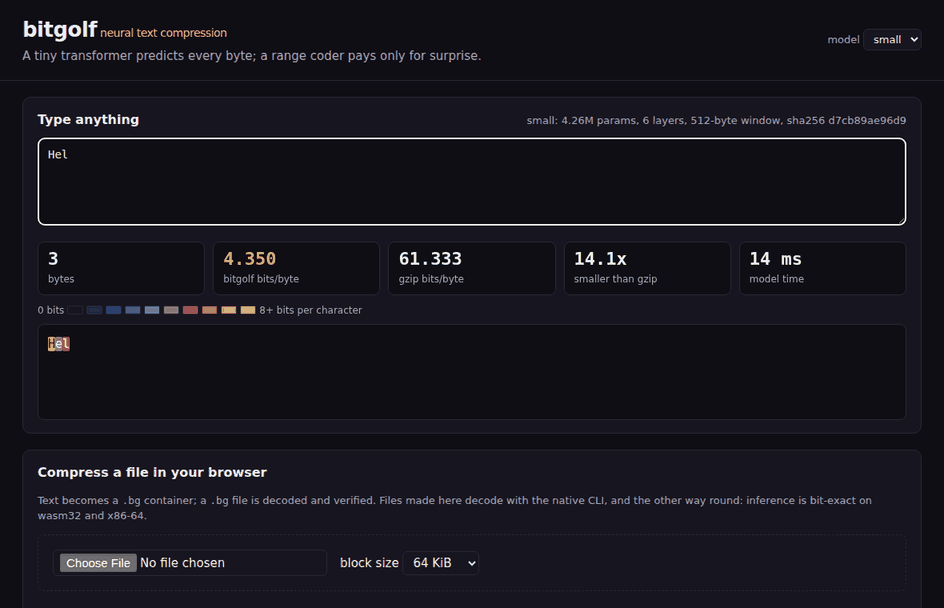
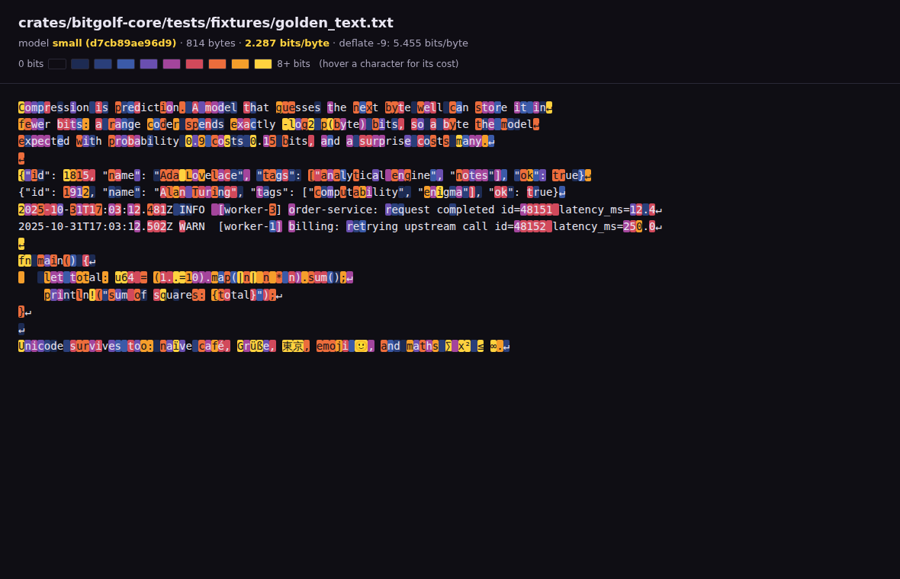
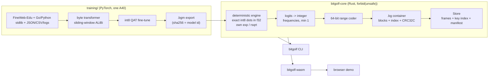
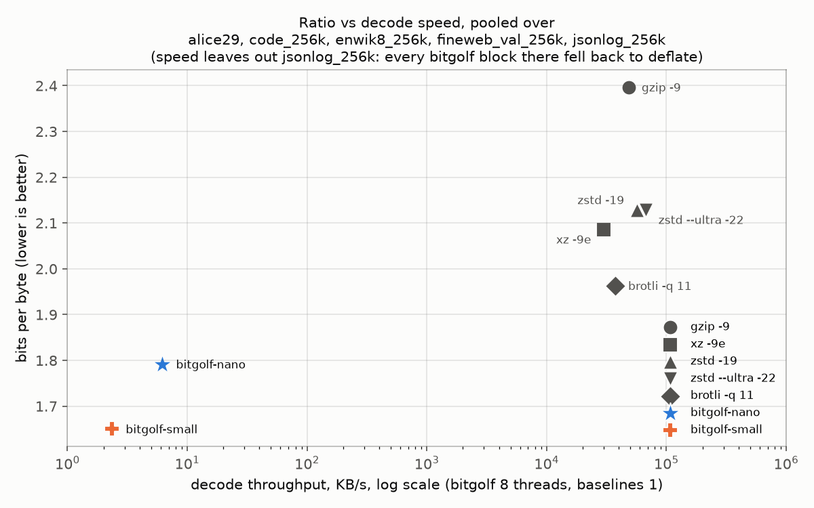

# bitgolf

**A storage engine that keeps web text and source code at 1.3-1.5 bits per byte.** A tiny
byte-level transformer predicts every next byte, and a range coder spends only as many bits as
the model is surprised. Inference is bit-exact Rust, so the same file decodes identically
natively and in your browser.

[](https://github.com/aamodbhatt/bitgolf/actions/workflows/ci.yml)
[](LICENSE)




*The live demo, running the 4.3M-parameter model as WebAssembly in Chromium. Dark characters
cost almost nothing; yellow ones surprised the model. Recorded from the real page.*

| Held-out web prose (256 KB, never trained on) | bits/byte | size vs bitgolf-small |
|---|---:|---:|
| **bitgolf-small** (4.3 MB model, real `.bg` file, round trip verified) | **1.503** | 1.00x |
| bitgolf-nano (0.78 MB model) | 1.640 | 1.09x |
| brotli -q 11 | 2.488 | 1.66x |
| xz -9e | 2.702 | 1.80x |
| zstd -19 | 2.742 | 1.82x |
| gzip -9 | 3.054 | 2.03x |

## Why

Compression is prediction. If a model assigns probability `p` to the byte that actually comes
next, an arithmetic coder can store that byte in `-log2 p` bits: a byte the model saw coming
with 90% confidence costs 0.15 bits, a coin flip costs 1 bit, a total surprise costs up to 20.
So the better the model predicts, the smaller the file, and "bits per byte", the number
language-model researchers already minimise, *is* the compressed size.

bitgolf is that idea taken seriously as a storage format: a versioned container, random
access, a crash-safe key/value store, a CLI, and a browser build, all sharing one inference
engine that produces the same bits everywhere.

## What it does

- **Compresses text with a neural model**: two int8 byte-level transformers (0.75M and 4.3M
  parameters) trained on an openly licensed mix of web prose, source code and structured text.
- **Bit-exact everywhere**: no libm, no FMA, no intrinsics; matrix products are exact integer
  arithmetic carried in `f32`. Golden hashes of every logit match between x86-64 (baseline and
  AVX2) and wasm32 (scalar and SIMD128 under Node, and the web build in Chromium). CI checks
  the baseline x86-64 build and both wasm32 builds under Node on every push.
- **`.bg` container**: independent 64 KiB blocks (random access, parallel decode), CRC32C on
  every structure, per-block fallback to deflate so binary data is never worse than deflate.
- **Store API**: `Store::open / put / get / scan / stats`, values packed into compressed
  blocks with a persisted key index; crash-safe (fsync, atomic manifest rename) and tested
  against simulated torn writes. A `get` decodes one block prefix.
- **CLI**: `compress`, `decompress`, `cat --block`, `info`, `bench`, `heatmap`,
  `store put|get|scan|stats|import`, `serve`.
- **Browser demo**: type and watch a per-character surprisal heatmap with running bits/byte
  versus gzip (`CompressionStream`); compress and decompress files fully in the tab.

## Quickstart

Requires Rust 1.85+. The trained models are in `models/`.

macOS / Linux:

```bash
git clone https://github.com/aamodbhatt/bitgolf && cd bitgolf
cargo build --release
./target/release/bitgolf compress README.md --model small   # writes README.md.bg
./target/release/bitgolf info README.md.bg --blocks
./target/release/bitgolf decompress README.md.bg -o roundtrip.md
./target/release/bitgolf heatmap README.md -o heatmap.html    # open in a browser
./target/release/bitgolf serve                                # demo on http://127.0.0.1:8091
```

Windows (PowerShell):

```powershell
git clone https://github.com/aamodbhatt/bitgolf; cd bitgolf
cargo build --release
.\target\release\bitgolf.exe compress README.md --model small
.\target\release\bitgolf.exe decompress README.md.bg -o roundtrip.md
.\target\release\bitgolf.exe serve
```

`bitgolf heatmap` writes a self-contained page that colours every byte by the bits it cost.
Here it is on the 814-byte test text (prose, JSON, logs, Rust and Unicode): 2.287 bits/byte
with the small model, against 5.455 for deflate -9 on the same tiny file.



The key/value store:

```bash
bitgolf store import ./kv events.jsonl --prefix ev/   # one value per line
bitgolf store get ./kv ev/00000042
bitgolf store scan ./kv ev/0000004 --keys-only
bitgolf store stats ./kv
```

The browser build ships prebuilt in `web/pkg`; rebuild it with `scripts/build-wasm.sh`.

## How it works



**The determinism trick.** A range decoder must rebuild exactly the same frequency table the
encoder used, so every logit has to be bit-identical on every machine. Three things make that
true without giving up speed:

1. *Exact dot products.* Weights and activations are int8. bitgolf stores them as `f32` integers
   and multiplies in `f32`: each product is at most 127^2 and every partial sum stays below 2^24,
   so float addition is exact and its order cannot matter. The compiler is free to use any SIMD
   width, and the result is still identical.
2. *No platform math.* `exp` (softmax), `rsqrt` (RMSNorm) and rounding are a few lines of IEEE
   `+ - * /` with fixed evaluation order. Rust never contracts into FMA on its own.
3. *Fixed reduction order* for the few sums that are not exact (norms, softmax denominators),
   and attention keys visited in distance order so cache layout cannot reorder them.

**Lockstep blocks.** Blocks are independent, so the encoder and decoder advance a group of
blocks by one byte per model step: every weight row is loaded once and reused across the
group. Groups run on all cores with rayon. Batching changes speed, never bits.

**Models built for CPUs.** Multi-query attention (one shared K/V head) keeps the per-block KV
cache small; ALiBi needs no position tables; ReLU^2 needs no transcendental functions; training
uses sequences twice the 512-byte window with a sliding mask, so the model works with a ring
buffer that has long since evicted the start of the block.

Details, invariants and failure modes are in [docs/DESIGN.md](docs/DESIGN.md).

## Results

Measured on RunPod machines: one NVIDIA A40 for training (shared with other jobs), and an
Intel Xeon Gold 6342 with an **8-vCPU quota on a heavily shared machine** (load average 10-24)
for compression, so throughput numbers are pessimistic and noisy. The nano and baseline rows
come from the training session; the small rows were measured in a second session on a fresh
pod with the same CPU, on byte-identical inputs (every baseline reproduced its exact size).
bitgolf was built with a plain `cargo build --release` (no `target-cpu` flags), 32 KiB blocks,
8 threads. Every bitgolf number below is the size of a real `.bg` file whose decompression was
verified byte for byte.

**Coded size, bits per byte (lower is better), same bytes for every method:**

| corpus | bitgolf-small | bitgolf-nano | brotli -q 11 | xz -9e | zstd -19 | gzip -9 |
|---|---:|---:|---:|---:|---:|---:|
| FineWeb-Edu validation, first 256 KB (held out) | **1.503** | 1.640 | 2.488 | 2.702 | 2.742 | 3.054 |
| held-out Go `net/http` + Python `asyncio`, 256 KB | **1.290** | 1.491 | 1.921 | 2.004 | 2.029 | 2.325 |
| enwik8, first 256 KB | **1.916** | 2.149 | 2.237 | 2.414 | 2.495 | 2.757 |
| alice29 (Canterbury, whole file) | 2.499 | 2.633 | **2.445** | 2.553 | 2.589 | 2.850 |
| JSON manifests + dpkg/apt logs, 256 KB | 1.399 | 1.399 | **0.927** | 0.954 | 0.984 | 1.189 |



*Bits per byte pooled over the five files above (total coded bits over total bytes). Decode
speed pooled over the four files the model actually decoded (total bytes over total decode
time, same files for every method): on the JSON/log file every bitgolf block fell back to
deflate, which would otherwise inflate bitgolf's speed. Every row, with encode and decode
speeds, is in [docs/results/results.md](docs/results/results.md).*

- bitgolf-small wins clearly on text like its training mix (web prose 40% smaller than brotli,
  source code 33% smaller) and on Wikipedia markup it never saw (14% smaller).
- The 5.6x larger model buys 5-13% over nano on every text file (alice29 5%, web prose 8%,
  enwik8 11%, code 13%). For reference, its validation cross-entropy (PyTorch, int8 simulated)
  is 1.583 bits/byte on the web-prose split and 1.203 on the code split.
- Both models lose on 19th-century literature, small only narrowly (2.499 vs brotli's 2.445,
  ahead of xz), and badly on highly repetitive JSON/logs: a 512-byte window cannot see the long
  repeats LZ77 exploits. On that file every block fell back to deflate for both models
  (identical 45,844 bytes), which is the format's "never worse than deflate" guarantee doing
  its job.
- Hutter-style honesty: add the model to the archive and nano costs 0.78 MB up front, small
  4.33 MB, so they only pay off for corpora of several MB or for many files sharing one model.

**Quantisation cost** (validation bits/byte, web prose): nano 1.734 float -> 1.736 int8
(+0.002) -> 1.721 after the int8 fine-tune; small 1.593 -> 1.594 (+0.0006) -> 1.583.

**Full-file baselines** (bits/byte): enwik8 (100 MB): gzip 2.916, zstd -19 2.156,
brotli 2.059, zstd --ultra -22 2.027, xz -9e 1.987. dickens (10 MB): gzip 3.023, zstd -19
2.237, xz 2.222, brotli 2.220. bitgolf was not run on the full 100 MB: at the throughput below
that would take hours on this shared machine. For reference, published results for
context-mixing and online-trained neural compressors (cmix, nncp) are roughly 1.1-1.2
bits/byte on enwik8 (Large Text Compression Benchmark); they are quoted, not reproduced here,
and adapt to the file for hours rather than using a small frozen model (0.75M or 4.3M
parameters).

**Throughput** with 8 threads on the loaded pod: bitgolf-nano encoded at 4.3-6.8 KB/s and
decoded at 4.1-7.5 KB/s, bitgolf-small at 1.6-3.0 and 1.7-3.3 KB/s (decode of the JSON/log file
is left out: its blocks fell back to deflate and decode at deflate speed). Thread scaling on the
first 128 KiB of lcet10, which is four 32 KiB blocks (so at most four cores are busy, and one
thread codes all four in lockstep): nano 1.7 -> 3.3 KB/s encode and 1.8 -> 4.5 KB/s decode,
small 0.57 -> 1.76 and 0.57 -> 1.98 KB/s, from 1 to 8 threads (nano's one-thread row is from
the first session). This is neural-compression speed, four orders of magnitude below zstd; the
design trades speed for ratio and portability.

**Determinism** (all identical, checked by golden hashes of every logit and of the
compressed bytes): x86-64 baseline build, x86-64-v3 (AVX2/FMA) build, wasm32 under Node,
wasm32 with SIMD128 under Node, and wasm32 in headless Chromium.

The raw rows are appended to `runs/bench/rows.jsonl` on the benchmark machine and turned into
`docs/results/` (results.json, results.md, pareto.png) by `python -m bitgolf_train.bench report`.

## Testing

| Suite | What it proves |
|---|---|
| `rangecoder` / `freq` property tests | round trips for arbitrary tables and symbol streams, extreme skew and carries; tables always sum to 2^20 with every symbol >= 1 |
| `tests/parity.rs` | the Rust engine reproduces the PyTorch int8 reference logits (past the attention window) |
| `tests/golden.rs` + `determinism.mjs` | sha256 of all logits and of the compressed bytes match across x86-64 and wasm32 (scalar and SIMD128) for three models |
| `tests/codec.rs` | round trips (property-based, through the model path), random access per block, deflate/stored fallback, thread-count independence, every single-bit flip and truncation is detected |
| `tests/store.rs` | persistence, pending vs durable writes, corruption reports, and torn flushes at random cut points (property-based) recovering to the last commit |
| `bitgolf-cli/tests/cli.rs` | the real binary: compress, info, decompress (model found by hash), `cat --block`, heatmap, digest equals the golden, store import/put/get/scan/stats |
| `bitgolf-cli` serve routes | only whitelisted paths under `web/` and `models/` are servable (no traversal) |
| `training/tests` | quantiser bounds and straight-through gradients, sliding-window masking, `.bgm` round trip and tamper detection, an end-to-end CPU train -> QAT -> export run |

```bash
bash scripts/verify.sh                       # everything below, as CI runs it
cargo test --workspace                       # Rust: unit, property, parity, goldens, store, CLI
OUT=target/pkg bash scripts/build-wasm.sh && node crates/bitgolf-wasm/tests/determinism.mjs target/pkg
cd training && uv sync && uv run pytest -q   # Python (CPU)
```

## Training

```bash
cd training
uv sync
uv run python -m bitgolf_train.prepare --out ../data/train          # ~760 MB mixture
uv run python -m bitgolf_train.corpora --out ../data/corpora --node-root <npm dir>
uv run python -m bitgolf_train.train --config configs/pod.toml        # GPU
uv run python -m bitgolf_train.train --config configs/laptop.toml     # CPU-sized
uv run python -m bitgolf_train.bench baselines --corpus ../data/corpora/alice29 ...
uv run python -m bitgolf_train.bench bitgolf --models ../models/bitgolf-small.bgm --corpus ...
uv run python -m bitgolf_train.bench report                           # docs/results
```

Data sources and licenses are listed in [docs/DATA.md](docs/DATA.md); the evaluation files
are never read by the training pipeline.

## Project layout

```
crates/bitgolf-core     engine, range coder, container, codec, store (no unsafe, pure Rust)
crates/bitgolf-cli      the `bitgolf` binary (incl. heatmap and demo server)
crates/bitgolf-wasm     wasm-bindgen bindings + Node determinism test
web/                    static demo (ES modules, Web Worker, no framework); web/pkg is the wasm build
models/                 trained .bgm models (nano, small)
training/               PyTorch training, QAT, export, corpora, benchmarks, tests
docs/                   DESIGN.md, DATA.md, results/, assets/
```

## Roadmap

- LZ-assisted context (feed long-range matches to the model) to close the gap on highly
  repetitive data.
- Larger models and longer training; a priming-preamble and block-size study.
- Store compaction and deletes; memory-mapped reads.
- Parallel in-browser compression with a worker pool.

## License

MIT, see [LICENSE](LICENSE). Copyright (c) 2026 Aamod Bhatt.
